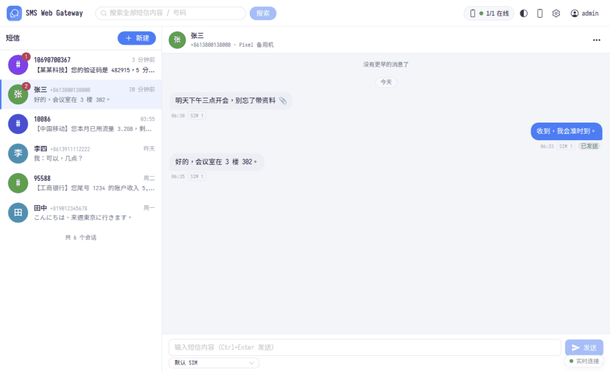
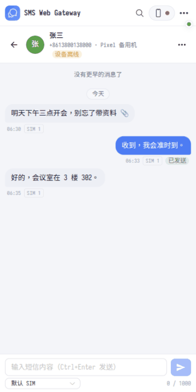
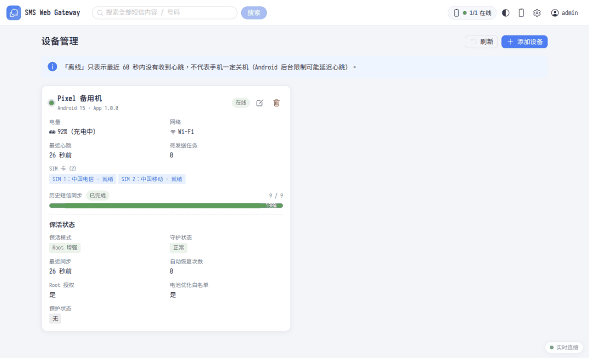
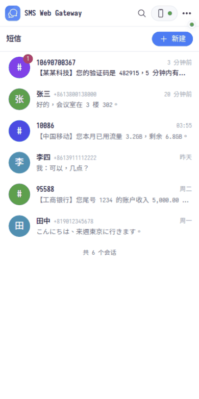
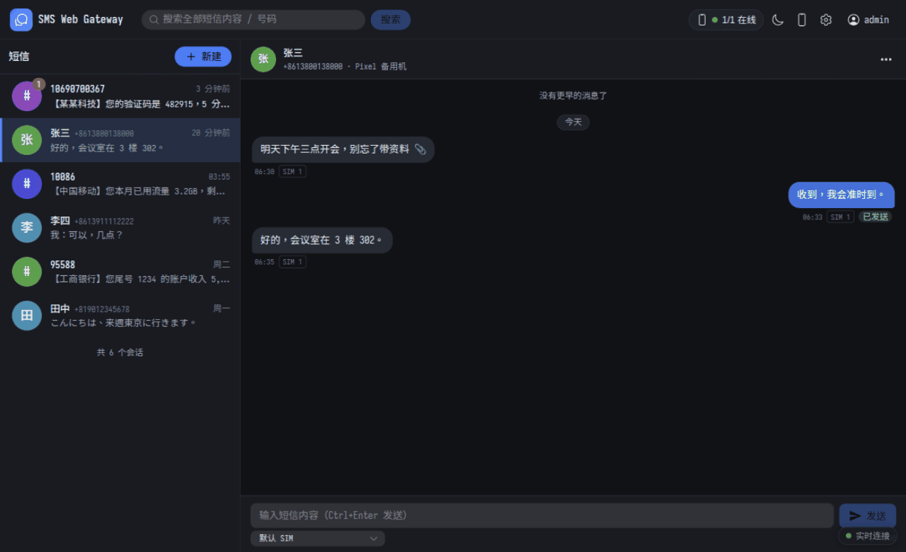

<div align="center">


# SMS Web Gateway

**把一部闲置的 Android 手机，变成可以远程使用的自托管短信网关。**<br/>
在浏览器里查看全部历史短信、实时收短信、发短信、管理多台设备 —— 数据完全在你自己手里。

[](LICENSE)


[快速开始](#-快速开始) · [功能](#-功能) · [截图](#-截图) · [架构](#-架构) · [文档](#-文档) · [安全](#-安全与可靠性)

</div>

---

## 为什么做这个

很多人手里有一部插着副卡的旧手机：收验证码、收银行通知、做短信转发……但每次都要把手机拿在手上。
**SMS Web Gateway** 让手机继续待在角落里充电，你在任何地方用浏览器就能管理它的短信。

- 🔒 **完全自托管**：不依赖 Firebase / FCM / Google Play Services / 任何第三方短信平台。
- 🌐 **无需公网 IP**：手机主动连接服务器，不要求和服务器在同一局域网。
- 🛡️ **宁可少发，不可重发**：短信发送不可安全重试，系统围绕「绝不重复发送」设计。
- 🧰 **可选 Root 增强**：Root 只做增强与恢复，不是收发短信的必要条件。

## 📸 截图

<table>
  <tr>
    <td width="66%"></td>
    <td width="34%"></td>
  </tr>
  <tr>
    <td align="center"><sub>桌面端：会话列表 + 聊天，状态实时更新</sub></td>
    <td align="center"><sub>手机浏览器：自适应单列布局</sub></td>
  </tr>
  <tr>
    <td></td>
    <td></td>
  </tr>
  <tr>
    <td align="center"><sub>设备管理：电量、网络、SIM、同步进度、保活状态</sub></td>
    <td align="center"><sub>手机端会话列表</sub></td>
  </tr>
</table>

<details>
<summary>深色模式</summary>



</details>

> 截图中的号码与短信内容均为虚构的演示数据。

## ✨ 功能

| | |
|---|---|
| 📥 **历史短信同步** | 首次连接即分批同步手机里已有的全部短信（每批 100 条，断点续传，支持数万条），以 `device_id + source_type + android_sms_id` 唯一去重 |
| ⚡ **实时接收** | 新短信入本地队列后立即上传，网页经 SSE 实时更新；断网时缓存，恢复后自动补传 |
| 📤 **网页发短信** | 任务队列 + 长轮询 + `SmsManager`；中文长短信、指定 SIM 卡、国际号码；状态 `queued → claimed → sending → sent → delivered / failed / unknown` |
| 🧷 **防重复发送** | 崩溃或自动恢复后遗留的 `sending` 任务只会标记为 `unknown`，交给管理员确认，**绝不自动重发** |
| 💬 **会话式界面** | 按联系人聚合、搜索、置顶、未读、深色模式、手机浏览器适配、数据导出 |
| 🔑 **验证码一键复制** | 自动识别短信里的验证码（规则参考 XposedSmsCode，宁可漏识别也不把金额/日期当验证码）；气泡里高亮 + 复制按钮，会话列表直接带复制芯片，顶栏「最近验证码」面板，新验证码到达时弹出带复制按钮的提示；局域网 http 访问也能复制 |
| 📊 **统计面板** | 每日收发、验证码数量、短信类别、发件方 Top 10、星期×小时热力图、按设备/SIM、发送成功率与失败原因、设备电量与在线率；纯 SVG 图表，零新增依赖 |
| 🤖 **AI 日报** | 对接任意 OpenAI 兼容接口（OpenAI / DeepSeek / 通义 / 智谱 / Ollama…）；分三档控制发什么（默认第 2 档：脱敏后的短信摘要；第 0 档只发聚合数字），默认关闭，发送前可预览完整请求；AI 不可用时自动回退为规则模板；可用宝塔计划任务每天自动生成 |
| 📱 **多设备管理** | 在线状态、电量、网络、SIM、同步进度、待发送任务、一次性二维码绑定 |
| 🛠️ **后台保活** | 前台服务 + WorkManager + 开机恢复；可选 Root 增强：电池白名单、分级恢复与冷却、保护状态、独立 Watchdog 模块 |
| 🚨 **安全开关** | 紧急暂停发送、发送频率限制、国际号码 / 疑似高资费确认、完整审计日志 |

## 🏗️ 架构

```
 浏览器 ──HTTPS──▶ Nginx ──▶ PHP 8.1+ · SQLite ◀──HTTPS（手机主动发起）── Android APK ──▶ SIM 卡
                                                                              ▲
                                                           Root Watchdog（可选，KernelSU / Magisk / APatch 模块）
```

| 目录 | 内容 |
|---|---|
| [`server/`](server) | PHP 后端（无框架，Controllers / Services / Repositories / Database 分层）、数据库迁移、CLI 工具、集成测试 |
| [`web/`](web) | Vue 3 + TypeScript + Naive UI + Vite 前端 |
| [`android/`](android) | Kotlin + Jetpack Compose 客户端（Room、WorkManager、OkHttp、前台服务、RootManager） |
| [`root-module/`](root-module) | 可选的 Root Watchdog 模块（纯 Shell） |
| [`docker/`](docker)、[`docker-compose.yml`](docker-compose.yml) | Docker 部署配置 |
| [`docs/`](docs) | [API 契约](docs/API.md)、[APK 与 Watchdog 的接口约定](docs/ROOT_INTERFACE.md) |

## 🚀 快速开始

> 先到 [Releases](../../releases) 下载构建好的文件：**宝塔部署包**、**Android APK**、**Watchdog 模块**。

### 方式一：宝塔面板（无需 Node / Docker）

1. 在宝塔创建 **PHP 8.1+** 站点，数据库选「不创建」。
2. 上传并解压 Release 里的 `smsgate-baota-clean.zip`。
3. 站点设置 → 网站目录 → 运行目录选 **`/public`**（⚠️ 必须，否则数据库可被下载；安装向导会检测并拒绝安装），并**关闭「防跨站攻击」**。
4. 站点设置 → 伪静态，粘贴包内 `nginx.rewrite.conf` 的内容。
5. 访问域名，系统自动进入 **`/install`** 安装向导；安装完成后向导**自动锁定并禁用**。

详细图文见 [BAOTA_SETUP.md](BAOTA_SETUP.md)。

### 方式二：Docker Compose

```bash
git clone https://github.com/LuoYue-cn/sms-web-gateway.git
cd sms-web-gateway
cp .env.example .env
docker compose up -d --build        # 默认 http://服务器IP:8080
```

打开 `/install` 完成环境检测并创建管理员；正式使用请在前面配置 HTTPS 反向代理，详见 [DEPLOYMENT.md](DEPLOYMENT.md)。

### 连接手机

1. 手机安装 `smsgate-release.apk`（调试可用 `smsgate-debug.apk`，允许本地 http）。
2. 授予短信权限。
3. 网页「设备管理 → 添加设备」生成二维码，手机扫码即自动绑定（也可手动输入服务器地址与配对令牌）。
4. 等待历史短信同步完成，之后即可在网页查看与发送短信。
5. *（可选）* 手机「设置 → Root 保活管理」启用 Root 增强。

详见 [ANDROID_SETUP.md](ANDROID_SETUP.md)。

> ⚠️ 手机绑定、同步、发送**必须使用 HTTPS**（release 包会强制校验证书，不提供忽略选项）。

## 🔐 安全与可靠性

短信里有验证码和银行通知，后台被攻破的损失比普通网站大，所以先把**现状与不足**说清楚：

| | 现状 |
|---|---|
| 登录防护 | 密码哈希；CSRF；Session 过期；**两层登录限流**（用户名+来源 IP；同一用户名跨来源总量，防撞库）。默认**不信任** `X-Forwarded-For`（曾有可伪造绕过的漏洞，已修复并有回归测试） |
| 2FA | ❌ **暂时没有**。建议在反向代理层加第二道门（IP 白名单 / Basic 认证 / VPN / Cloudflare Access），见 [SECURITY.md](SECURITY.md) |
| 数据库加密 | ❌ **SQLite 是明文**。请用整盘/数据卷加密，并加密备份；数据文件默认 `0640`；安装向导会检测 `data/` 是否可被网页读取，读得到就拒绝安装 |
| 设备凭据 | 设备令牌**只存 SHA-256 哈希**；绑定令牌 5 分钟、一次性、原子消费；支持轮换与吊销 |
| 手机端 | 令牌存 Android Keystore；release 包只信任系统 CA，不提供忽略证书错误的选项（内网自签见 [ANDROID_SETUP.md](ANDROID_SETUP.md#6-内网--自签证书怎么办)） |
| 注入/滥用 | 预处理 SQL；短信内容按纯文本渲染（AI 返回的日报同样不渲染 Markdown/HTML）；CSV 导出防公式注入 |
| AI 数据外发 | 默认关闭；**任何档位都不发短信原文、完整号码、联系人姓名和验证码**；发送前可预览完整请求；API Key 只写不读，也可只放服务器环境变量 |
| Root | **服务器没有任何下发 Shell 命令的接口**；Watchdog 只执行预定义检查，且**尊重用户的强制停止** |

完整说明见 [SECURITY.md](SECURITY.md)。

### 已验证的内容

| 项目 | 结果 |
|---|---|
| 服务端集成测试 | 105 项通过（去重、幂等、状态机、令牌、CSRF、登录限流与代理信任、SSE、验证码识别与回填、统计、AI 日报与脱敏、思考型模型的各种返回 ……）+ 53 组验证码/归类/脱敏样例 |
| Root Watchdog 脚本测试 | 266 项通过（dash + busybox，冷却/保护/强制停止/未解锁等场景） |
| 前端单元测试 | 32 项通过（验证码高亮、链接识别与安全、剪贴板回退 ……） |
| Android 单元测试 | 36 项通过 |
| 并发压测（SQLite WAL） | 10 台设备同时灌 20 万条 + 管理端轮询 + SSE + 发送队列：**0 错误、0 个 `database_busy`**（详见 [DEPLOYMENT.md](DEPLOYMENT.md#6-容量与调优)） |
| 真实 Nginx + PHP-FPM | SSE 缓冲实测、`data/` 可被下载的漏洞复现与防护验证 |
| 真机（Android 15 · KernelSU Next） | 绑定、历史同步（与系统短信库逐条核对）、崩溃后 `sending → unknown` 不重发、服务宕机后补传、Root 白名单与还原、解绑清理 |

```bash
python3 server/tests/api_test.py            # 服务端集成测试（会启动临时 PHP 服务）
php server/tests/extractor_test.php         # 验证码识别 / 归类 / 脱敏样例
sh root-module/tests/run_tests.sh           # Watchdog 脚本测试
(cd web && npm install && npm test)         # 前端单元测试
(cd android && ./gradlew testDebugUnitTest) # Android 单元测试
```

## ⚠️ 已知限制（如实说明）

- 普通应用只能读取系统短信库、接收广播并发送短信；**无法删除或修改手机上的短信**（需成为默认短信应用，本项目不做）。网页「删除」只删服务端记录。
- Android 15 对前台服务与后台启动有限制；无法持续长轮询时会退化为 WorkManager 周期同步，界面会显示同步延迟。
- `sent` 不代表对方已收到；`delivered` 仅在运营商与设备支持回执时出现。
- Root 保活**不保证**一定收到短信：SIM 信号、运营商服务、电话服务与硬件故障仍会影响。
- 不能声称端到端「恰好一次」发送，只能尽量避免重复；无法确定时会标记为 `unknown` 由人确认。
- PHP 8.1 已结束官方安全支持：代码保持 8.1 兼容，正式部署建议使用 8.3+。

## 📚 文档

| 文档 | 内容 |
|---|---|
| [BAOTA_SETUP.md](BAOTA_SETUP.md) | 宝塔面板部署 |
| [DEPLOYMENT.md](DEPLOYMENT.md) | Docker 部署、HTTPS 反向代理、备份与恢复 |
| [ANDROID_SETUP.md](ANDROID_SETUP.md) | 手机端安装、权限、绑定、Root 增强与回退 |
| [docs/API.md](docs/API.md) | REST API 契约 |
| [docs/ROOT_INTERFACE.md](docs/ROOT_INTERFACE.md) | APK 与 Watchdog 的接口约定 |
| [SECURITY.md](SECURITY.md) | 安全设计与已知限制 |
| [TROUBLESHOOTING.md](TROUBLESHOOTING.md) | 常见问题排查 |

## 🤝 参与

欢迎提 Issue 与 PR。提交前请先跑通上面的测试；涉及发送逻辑的改动请特别注意 [SECURITY.md](SECURITY.md) 里的「防重复发送」不变量。

## 📄 许可证

[MIT](LICENSE) © 2026 LuoYue-cn
